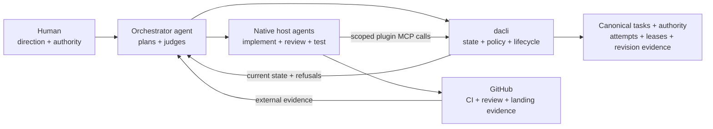

# dacli

<p align="center">
  
</p>

<p align="center"><strong>The control plane for autonomous coding-agent swarms.</strong></p>

    

dacli is a governance layer for agents running in their own coding host. Codex
is the first tested plugin integration: its native agents use a scoped MCP
session to read canonical tasks, register Git checkout attempts, acquire fenced
leases, publish committed revisions and submit revision-bound self-reports.
Humans provision authority and retain control over exceptions and releases.

Start with the [Codex plugin setup](plugins/codex/README.md) and
[native governance transport](docs/GOVERNANCE_NATIVE_MCP.md). The plugin runs a
local dacli MCP server; Codex runs the agents. It does not launch a nested Codex
CLI, invoke `dacli spawn`, or expose a CLI escape tool. The governance kernel and
structured protocol are host-neutral; other harness integrations still require
runtime testing before support can be claimed.

This is a **cooperative local preview**. Agents sharing an MCP connection share
one session identity. Self-reports are not trusted execution evidence, and direct
host filesystem or shell actions are outside these gates. Native acceptance and
the hosted control-plane service are implemented in source; qualification and
support claims are versioned separately from those source changes. Second-host
conformance remains unqualified. Owner-bound publication decisions can be
recorded and consumed once; they do not publish anything themselves. See the
[plugin's boundaries](plugins/codex/README.md#identity-and-recovery-boundaries).

Coding-agent launchers, their provider runtime adapters and generic supervision
have been removed from this checkout. The optional native controller records
bounded work and authorizes specific host actions through scoped sessions; the
host creates and executes coding turns. Historical records remain readable for
audit and recoverable cleanup. See the [native migration guide](docs/NATIVE_MIGRATION.md)
for removed commands and their current workflow, and the
[operator playbook](docs/OPERATOR_PLAYBOOK.md) for day-to-day operation.

The latest stable published release remains
[v0.3.1](https://github.com/dacharika/dacli/releases/tag/v0.3.1) and contains the
legacy CLI; no tagged native release is available. Build the native preview
from a reviewed source checkout using the [installation](#install) section
below. A Homebrew formula is not currently shipped.



> Canonical tasks are Markdown on disk; native session authority and receipts use private durable state. The Go module includes PostgreSQL and platform support dependencies; the local plugin bootstrap requires Python 3.

An agent that spawns subagents has one hard problem: **each child starts blind.** It re-reads the codebase, re-derives decisions its siblings already made, and re-attempts work that already failed. `dacli` is the shared workspace that fixes this — a durable, human-readable project state that any agent in the tree can query, and that the parent can slice down to exactly the context a given child needs.

Canonical project documents are Markdown with YAML frontmatter and `[[wikilinks]]`. Native authority credentials and decision records have separate private storage. That means git diffs it, `grep` searches it, GitHub renders it, Obsidian opens the workspace as a vault with no plugin, and you can fix it by hand when an agent writes something stupid.

## Native governance and shared workspace

| Capability | Boundary |
|---|---|
| Canonical context | Tasks, dependencies, decisions and findings survive host sessions; `dacli context` assembles a bounded brief. |
| Scoped native sessions | An owner enrolls credentials for one workspace and task scope; every native MCP request reauthenticates. |
| Attempts and leases | Register an externally created clean Git checkout, acquire a fenced lease, and publish an observed committed revision. |
| Revision evidence | Agent self-reports remain self-reports. Trusted verification and independent review require separately issued authority. |
| GitHub projection | Publish public-safe task fields by default; internal material requires recorded authority and explicit `--include-internal`. |
| Historical recovery | Read prior runs and receipts; cleanup preserves unknown state and requires an exact reviewed plan. |

The coding host creates and supervises agents. dacli governs the operations that
pass through its scoped interfaces; it cannot prevent direct filesystem or
shell writes by a host process.

## The core idea

```bash
dacli context task/042 --budget 4000
```

One command returns a single self-contained markdown brief: the task, the goal it serves, the constraints that bound it, the decisions already made that it must not relitigate, and the findings its siblings have reported — trimmed to fit a token budget, most-relevant-first.

You hand that to a subagent instead of the whole repo. That is the product. Task tracking is the substrate that makes it possible.

## Status

**Alpha — native plugin preview.** Codex is the first measured host integration.
The Go module includes PostgreSQL and platform support dependencies; the plugin bootstrap requires Python 3.
A shared MCP connection identifies one enrolled session, not every native child.
The current implementation does not certify independent reviewers from host
labels, role names or transcripts.

The [documentation index](docs/README.md) distinguishes working primitives from
historical experiments and the [hosted control-plane skeleton](docs/CONTROL_PLANE.md).
The multi-tenant hosted product is not shipped. See [DESIGN.md](DESIGN.md) for the
boundary and [WALKTHROUGH.md](docs/WALKTHROUGH.md) for a native task workflow.

## Shared canonical documents

- **Obsidian** is where humans read and write documents.
- **GitHub** is where humans coordinate and work becomes visible outside the session.
- **`dacli`** (CLI and MCP) is where agents work.

These surfaces share the canonical Markdown documents. GitHub is a projection that can be regenerated; local documents remain the source for tasks and context. Native session authority, leases and receipts use a separate private durable aggregate, not the Markdown task store.

## Install

**Native plugin preview from this reviewed checkout** (requires Go 1.22+ and
Python 3 for the plugin bootstrap):

```bash
go build -o ./dacli ./cmd/dacli
./dacli native serve --help
./dacli native enroll --help
./dacli native revoke --help
```

Use the absolute path of that binary in the
[plugin connection setup](plugins/codex/README.md). The plugin source and native
commands must both be present in your checkout. Version v0.3.1 does not
contain them; neither its archive nor the following released-version install is
an installation of this native preview.

**Legacy CLI from the latest published Go version:**

```bash
go install github.com/mlnomadpy/dacli/cmd/dacli@latest
```

**Legacy CLI prebuilt release:** download the archive for your OS and architecture from
the [latest GitHub release](https://github.com/mlnomadpy/dacli/releases/latest),
verify it against `checksums.txt`, and place `dacli` on your `PATH`.

For example, GitHub CLI can download the complete verified v0.3.1 asset set:

```bash
mkdir dacli-v0.3.1
gh release download v0.3.1 --repo mlnomadpy/dacli --dir dacli-v0.3.1
cd dacli-v0.3.1
shasum -a 256 -c checksums.txt # use sha256sum -c on Linux
```

Release assets cover darwin, Linux, and Windows on amd64 and arm64; Windows
uses zip and the other platforms use tar.gz. Each archive has a matching SBOM.

After installation, negotiate the bundled agent guidance against the binary
instead of assuming a version number implies a command surface:

```bash
dacli version --compatibility --json
dacli capabilities --json
```

## Workspace quickstart

```bash
dacli init --name "payments-refactor"
dacli project add "Migrate billing to the new ledger" --slug ledger
dacli task add "Audit every write path into balances" --project ledger \
  --accept "Record the observed write paths and verification evidence"
dacli context ledger/001 --budget 3000
dacli status --project ledger
```

Then follow the [private native session setup](plugins/codex/README.md).
The owner provisions authority outside the repository and enrolls an explicit
task scope. The host's plugin tools read that task, register a clean external
checkout, acquire a lease, publish a committed revision and submit self-reported
evidence. Do not substitute a legacy `DACLI_AGENT` token or an operator fallback
for this connection.

GitHub is a projection: inspect `github projection`, preview `github pull` or
`github push`, and publish only within explicit user authority. A task PR
references its issue until terminal acceptance; native evidence submission
does not close either one.

## Command reference

The primary shipped surface is grouped below. It is a journey map, not a
hand-maintained compatibility manifest: run `dacli help --all` for the complete
catalog and `dacli capabilities --json` for authoritative command, flag, JSON,
mutation, state-schema and MCP capabilities. Agent-critical
read paths advertise versioned `--json` contracts there; explicitly human-only
views name their typed replacement rather than pretending prose is JSON.

**Workspace & onboarding**

| Command | Purpose |
|---|---|
| `dacli init` | Create a `.dacli` workspace (`--template` seeds a process, `--roster` seeds roles) |
| `dacli adopt` | Onboard an existing repo: init, project, codebase map, TODO tasks |
| `dacli whoami` | Show the acting agent and its grant |
| `dacli overview` | Human summary or bounded `--json` aggregate of projects, WIP, activity, and ready-now tasks |
| `dacli status` | Tree-wide project state in one screen |
| `dacli doctor` | Detect management anti-patterns in tasks, risks, and the log |
| `dacli version` / `dacli capabilities` | Print version/compatibility diagnosis; inspect the machine-readable live surface |

**Native host integration**

| Command | Purpose |
|---|---|
| `dacli native bootstrap` / `native enroll` | Owner-only private authority provisioning and scoped session enrollment |
| `dacli native serve` | Authenticate an explicit private connection and serve the bounded native MCP catalog |
| `dacli native revoke` | Owner-only session revocation, checked by subsequent calls on existing connections |
| `dacli native upgrade` | Explicit owner-authorized schema migration; no automatic reset |

See the [native transport](docs/GOVERNANCE_NATIVE_MCP.md) for exact configuration
and tool schemas. Native owner commands are local-only.

**Planning — projects, tasks, risks**

| Command | Purpose |
|---|---|
| `dacli project add\|list\|show` | Create, list, show projects |
| `dacli project rm <slug> --force` | Delete a project and everything filed under it (irreversible) |
| `dacli task add\|list\|show` | Create, list, show tasks |
| `dacli task claim\|check\|done\|block` | Take ownership, check acceptance boxes, close (verifies, refuses if unmet), block |
| `dacli task aggregate` / `task decompose` | Preview/apply content-addressed aggregate repair or safe decomposition of an oversized leaf |
| `dacli task progress` / `slice add\|reconcile` | Derive parent delivery progress; create and bind independently landable child slices |
| `dacli risk add\|list` | Record and rank risks in the impact × likelihood matrix |
| `dacli wbs` | Work breakdown tree (`task add --parent` builds it) |
| `dacli glossary` | Show or edit the project term list |

**Context & knowledge**

| Command | Purpose |
|---|---|
| `dacli context <ref>` | **Assemble a scoped context brief for an agent — the main event** |
| `dacli note add` | Record a decision, finding, metric, or reference |
| `dacli retro` | Harvest a task/project: went well, didn't, improve |
| `dacli prompt list\|show` | The prompt registry and one prompt's resolved template |

**Collaboration & the event log**

| Command | Purpose |
|---|---|
| `dacli sync` | Apply pending child events to objects you own |
| `dacli events tail` | Follow the append-only write log |
| `dacli ask` / `answer` / `threads` | Ask a blocking question, answer it (becomes a durable note), list threads |
| `dacli escalate` | Escalate out of the tree to a human (`--github` files an issue) |

**SPM & insight**

| Command | Purpose |
|---|---|
| `dacli lint` | Format, INVEST, requirements-quality, and ambiguity checks |
| `dacli next` | What to work on now: MoSCoW, then critical path (`--parallel N`) |
| `dacli estimate` | PERT three-point estimate widened by the Cone of Uncertainty |
| `dacli critical-path` | CPM: full schedule with slack; a star marks the critical path |
| `dacli burndown` / `velocity` | Points remaining vs done; completions per active day |
| `dacli standup` | Per-agent roll-up: done, doing, impediments — derived, never filed |
| `dacli calibrate` | Te vs actuals: the empirical multiplier by size and agent band |
| `dacli taint` | Blast radius of a suspect source over event/note origins |
| `dacli explain` | Sourced, freshness-labelled task/project explanation: rank, workers, blockers, routing, landing, next action |

**Teams & roles**

| Command | Purpose |
|---|---|
| `dacli agent spawn\|tree\|retire` | Mint or retire a durable child identity; show lineage and attribution |
| `dacli role add\|list` | Define a role (skills, scope, shortcuts, escalation); list roles |
| `dacli team` / `team route` | Roster with live-process WIP occupancy/headroom; who owns a path and the chain to reach them. Agent files are identity history; `agents` reports current liveness. |

**Shortcuts & queues**

| Command | Purpose |
|---|---|
| `dacli shortcut add` | Define a shortcut (a memoized, effect-gated command template) |
| `dacli shortcut promote` | Materialize a twice-run ad-hoc `run --cmd` command into a named shortcut |
| `dacli run` | Expand and run a shortcut (`--dry-run`, `--confirm`, `--list`) |
| `dacli queue add\|list\|next\|advance` | Ordered step lists with owned cursors (`advance --fail` halts) |

**Review, verification and historical evidence**

| Command | Purpose |
|---|---|
| `dacli review record` / `dacli review projection` | Persist an identity/tree-bound structured review result; render its public-safe GitHub projection |
| `dacli accept` | Verify an agent's completion and close the task in one owner step |
| `dacli accept propose` / `accept apply` | RO reviewer creates an exact-tree evidence handoff; owner applies it without sharing a token |
| `dacli agents` | Bounded sourced historical worker observations with `--active-only`, `--limit`/`--cursor`, and explicit `--history` |
| `dacli logs` | Read/follow transcripts; agents and MCP use bounded JSON chunks with `--cursor`/`--limit` |
| `dacli task status <ref>` | One freshness-sourced task view: claims, runs, review, landing, and next action |
| `dacli runs list\|show` | Read retained runs and one run's detail |
| `dacli replay` | Reconstruct a run as brief + events interleaved (offline) |
| `dacli handoff show\|consume` | Inspect and root-acknowledge a hash-bound worker lifecycle handoff without widening authority |

**Skills, templates & stage gates**

| Command | Purpose |
|---|---|
| `dacli skill add\|list\|show` | Author a workspace skill; list with delivery floors; show one |
| `dacli skill promote` | Owner-only: distill a workspace lesson into a versioned skill |
| `dacli skill import\|fetch\|compile` | Ingest a native skill tree; fetch from skills.sh; materialize for a role×runtime |
| `dacli template list\|show\|add` | Project templates, their stages/gates, vendor one for editing |
| `dacli stage` / `stage advance` | Current stage + gate status; advance if the gate opens |

**Version control, shipping & the GitHub mirror**

| Command | Purpose |
|---|---|
| `dacli commit` | Commit as yourself: author = agent (role), with dacli trailers |
| `dacli blame` / `contrib` | Who wrote each line; per-role/per-agent contribution rollup |
| `dacli worktree add\|list\|remove` | Isolated worktree+branch per task, created from the project's observed landing base so parallel agents neither collide nor inherit the operator's feature branch |
| `dacli push` / `pr` / `merge` | Push a branch; open a policy-projected task/slice PR; merge (a conflict blocks, never half-merges) |
| `dacli pr diagnose\|wait\|land` | Classify the canonical PR/CI blocker, wait within an explicit bound, then delegate governed landing |
| `dacli integrate` | Merge task branches (`--tasks` or all done) into `--into`, cleaning up |
| `dacli github doctor\|link\|projection\|push\|pull\|sync` | Probe gh/auth; bind a project; inspect policy; mirror tasks↔issues both ways |
| `dacli branches audit\|prune` / `cleanup` | Preview exact content-addressed cleanup, then apply only the observed safe plan |
| `dacli release train` | Resume a checks/reviews/artifacts-gated source→target promotion PR; never tags or publishes |

**Serving & self-report**

| Command | Purpose |
|---|---|
| `dacli mcp serve [--operator]` | Serve MCP over stdio with `DACLI_AGENT`; `--operator` explicitly selects local root only when no token is set ([setup](docs/MCP.md)) |
| `dacli report` | File a dacli-tool bug upstream via gh (explicit; never automatic) |

## Teams and shortcuts

Roles, ownership routes and escalation notes help the host assign work. They do
not mint native session authority or prove reviewer independence. Separate native
review grants bind eligible credentials and exact revision evidence; see
[the review contract](docs/GOVERNANCE_NATIVE_REVIEW.md).

Shortcuts remain explicit effect-gated command templates for bounded tools such
as tests. They are not coding-agent adapters or a native MCP shell escape. Host
sandbox and approval settings remain the operator's responsibility.

## The SPM layer

`dacli` is not a neutral container for whatever an agent writes down. The object model encodes software product management frameworks directly, so an agent using `dacli` at all organizes its work the SPM way without being told to: MoSCoW priority, INVEST checks, PERT three-point estimates, the Cone of Uncertainty, WBS, CPM with typed dependencies, the impact×likelihood risk matrix, GQM metrics, review severity, and the eleven categories of ambiguous language.

Full mapping in [docs/SPM.md](docs/SPM.md) — including an explicit list of the frameworks that **do not** port to agent work and are deliberately absent. Three things it argues:

- **Ambiguity linting is the highest-leverage check here.** Human teams tolerate vague requirements because a developer walks over and asks. A subagent doesn't walk over and ask — it guesses, confidently, and the guess is the deliverable. `dacli lint` flags "handle all the errors properly" on three categories at once.
- **The critical path is a parallelism scheduler.** For a human team, CPM says where a delay hurts. For a parent agent it says which tasks to spawn children on *first* — fanning out onto slack tasks while the critical path idles is wasted concurrency, and it's the default agent behavior.
- **Tokens replace time.** Velocity, burndown, and time boxes port only with that substitution, and they come nearly free: the event log already timestamps and attributes every write.

## Design decisions worth knowing before you adopt it

- Canonical Markdown is readable and editable; direct host file writes bypass cooperative tool gates.
- Native authority uses private durable state with serialized authenticated transitions. Append-only workspace events serve a different purpose.
- The host owns agents, delegation and spend. dacli has no provider launcher or autonomous service controller.
- Historical run records remain evidence, never native credentials or permission to resume a removed launcher.
- There is no Obsidian plugin: open the workspace as a vault.

## License

[BSD 3-Clause](LICENSE). Copyright © 2026 Taha Bouhsine.
