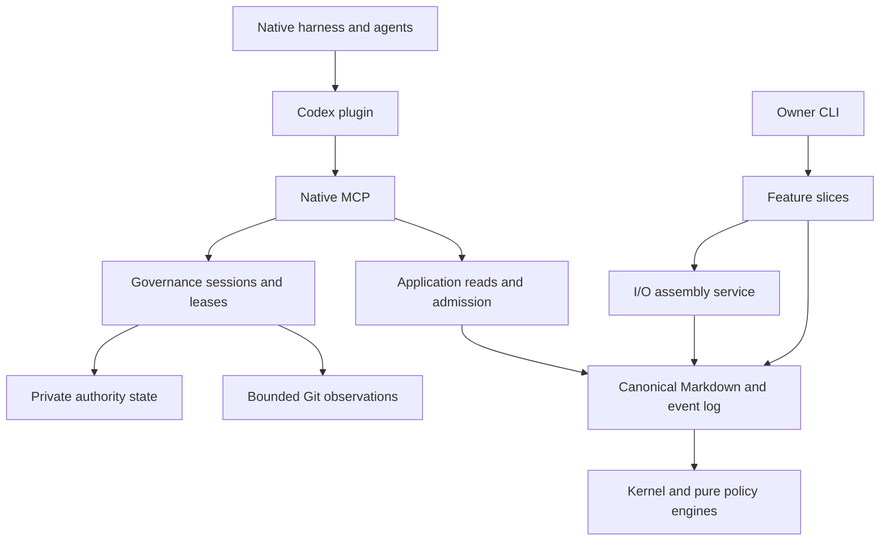
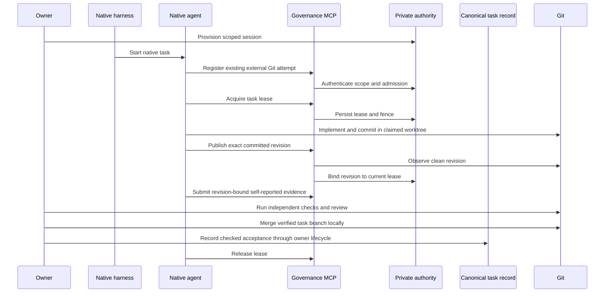
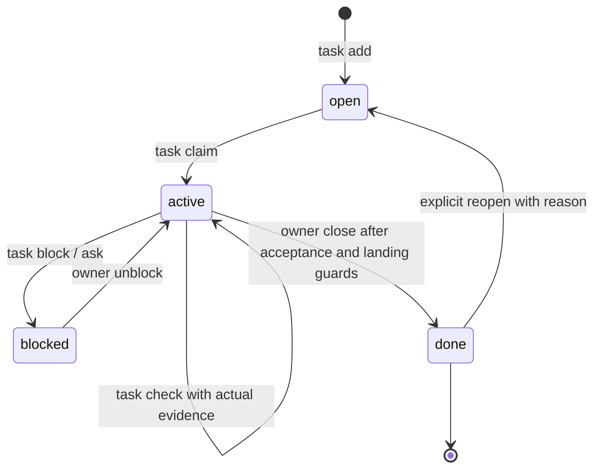

# Architecture diagrams

These diagrams describe the current local product. Native harnesses create and run
agents; dacli supplies governance through the plugin and MCP. It has no provider
CLI launcher or provider-driven execution loop. The native connection is a scoped,
cooperative session, and shared connections share identity. Shell and filesystem
operations outside dacli tools remain outside these gates.

## 1. Component view

The feature-slice rule remains: slices never import one another. Shared behavior
belongs below features. `brief` is an **I/O assembly service** over workspace
entities. Scoped locks protect **serialized state transitions**; append-only event
history does not eliminate coordination requirements.

Current feature inventory:

- `wscore`, `onboard`, `planning`, `briefing`, `knowledge`
- `collab`, `insight`, `teamops`, `shortcuts`, `queues`
- `history`, `reviewing`, `stagegate`, `ghmirror`, `skillforge`, `vcs`
- `selfreport`, `acceptance`, `ship`, `catalog`, `dashboard`
- `reconciliation`, `cleanup`, `journal`, `slices`, `releasetrain`, `nativegovernance`

`history` reads retained runs, transcripts and handoff records. Recovery remains
owner controlled; historical process records are retained to prevent unsafe
cleanup. `reviewing` records and projects independent review results. Neither
slice launches a coding provider. User-owned shortcuts and bounded verification
checks remain separate from agent orchestration.

| Boundary | Source |
|---|---|
| CLI aggregation, dispatch and legacy MCP adapter | `internal/cli/cli.go` |
| Native MCP's narrow tool catalog | `internal/mcp/native` |
| Private owner provisioning and exact migration | `internal/features/nativegovernance` |
| Session, attempt, lease, evidence and review authority | `internal/governance/sessions` |
| Canonical task and event state | `internal/store`, `internal/eventlog` |
| Independent bounded verification | `internal/application/native_verification.go`, `internal/store/verification.go` |
| Import and removed-launcher boundaries | `internal/cli/arch_test.go`, `internal/cli/native_only_test.go` |

## 2. Sequence: native task work through local landing

The host owns agent scheduling and execution. The ten native MCP tools provide
attempts, leases, revision registration, self-reported evidence and reads. Native
canonical acceptance and publication adapters remain unfinished; owners use the
existing checked local lifecycle explicitly.

Evidence submission does not certify a check ran. Trusted verification has its
own owner-granted runner and exact revision guards. Host child labels do not
create independent authenticated identities. A refusal requires the stated
remedy; retries do not enlarge authority.

## 3. Canonical task lifecycle

Status is folder position: `tasks/open`, `active`, `blocked`, or `done`. Acceptance
is a guarded close path, not a fifth status. An external native attempt and its
lease are separate records and do not silently move the canonical task.

Non-owners propose through append-only events; owners apply authorized proposals.
The existing local owner commands retain their verification, independent-review,
exact-tree and landed-work gates. Check the current command help for the exact
contract rather than assuming every proposal is accepted automatically.

| Transition | Source |
|---|---|
| Task creation, claim, checks, block and reopen | `internal/features/planning` |
| Owner acceptance and verification/landing gates | `internal/features/acceptance` |
| Proposal materialization | `internal/eventlog/sync.go` |
| Local commit, worktree and merge operations | `internal/features/vcs` |
| Native session and lease transitions | `internal/governance/sessions` |

Exit codes remain **2** usage, **3** policy refusal, **4** not found and **1** other
errors. Unknown removed launcher commands return usage errors; they have no
fallback launch behavior.
