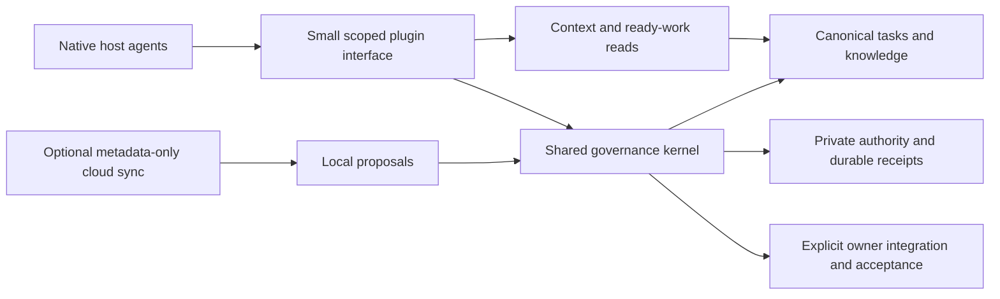

# dacli system audit and Beads comparison — 2026-10-22

The recommendation is to **continue in this repository**. The native governance
kernel and application boundaries are substantial reusable implementation.
The immediate problem is delivering and qualifying that implementation, making
the native workflow easier to resume, and keeping the backlog aligned with what
has actually shipped. Another repository or authority rewrite would increase
the delivery gap.

## Audit scope and evidence

The audit reviewed all 27 open GitHub issues, the local task inventory, public
branch/main metadata, local source and Git history, installed runtime build
metadata, plugin manifests/guidance, storage and artifact boundaries, hosted
composition, release configuration, and the Beads source documents listed below.
It made no production authority migration, credential enrollment, source push,
release, deployment or deletion. Behavioral suites and new live host/provider
qualification were not run, preserving the implementation-first instruction.
Source inspection establishes implementation presence, not runtime acceptance.

| Observation | Result |
| --- | --- |
| Inspected local source | `af496f9335ac7b650195be05102632969eaf5e7b` |
| GitHub `main`, read through GitHub API | `648c7ddd78d4bca292a48c99ceb2d3060aa0c691` |
| Local source versus matching `origin/main` | 227 commits ahead; 604 files changed; 108,235 insertions and 37,739 deletions |
| Installed runtime, read from Go build metadata | `cb42db5769407fb528e4e6e04289efd155c92f75`, unmodified build, darwin/arm64, cgo enabled |
| Cached Codex package manifest | 0.5.0; this version alone does not identify its kernel build |
| GitHub branch inventory | Five branches at inspection; early MCP identity hardening is published, assembled native baseline is absent |
| Open GitHub issues before changes | 27 |
| Canonical local core task folders | 28 open, 73 active, 3 blocked, 534 done, 5 removed |
| Local Git worktrees | 63 |
| Regular-file contents under `.dacli/worktrees` | 1,709,234,769 bytes, about 1.71 GB; not an allocation/reclaimability estimate |
| Regular-file contents under `.dacli/runs` | 92,720,569 bytes |
| Disk allocation observations | `.dacli` about 1.9 GB; `.git` about 56 MB |
| Beads source inspected | `9d6fff760b7a314b476539198504d77ce0959656` |

The local task and GitHub counts are different populations, not an equality
invariant. Many local integration tasks have no GitHub mapping, while some local
active/open records map to GitHub issues already closed. A checked local box is
also distinct from accepted, landed, published and installed work. Reconciliation
must observe those facts separately instead of mass-closing either backlog.

## Findings and delivery order

### P0: publish and qualify the assembled baseline

The remote main commit is the September pitch-deck merge. The reviewed local
tree contains the native migration, governance services, controller, independent
producer workflows and hosted composition, but those changes are not available
from the public default branch. The installed kernel is a third source revision.
Consequently, neither an old test receipt nor the plugin's 0.5.0 manifest proves
that a new public installation gets the implementation being discussed.

Track this as [#1088](https://github.com/mlnomadpy/dacli/issues/1088). Prepare
reviewable promotion slices, freeze the final source for applicable checks,
retain exact merge/artifact receipts, and qualify a fresh installation. This
audit does not authorize a release tag or automatically accept local tasks.

### P1: expose the existing context product through the native interface

[`internal/brief/brief.go`](../../internal/brief/brief.go) already assembles task
context, decisions, findings, trust labels and explicit budget omissions.
[`briefing.go`](../../internal/features/briefing/briefing.go) exposes CLI context
and catchup. The native worker catalog in
[`tools.go`](../../internal/mcp/native/tools.go) has task/identity/policy and
producer tools, but no assembled context or ready-frontier read. The separate
orchestration profile does not fill that default worker interface gap.

Add narrow authenticated reads by reusing existing services, not an unrestricted
CLI MCP gateway. Make startup/resume/context-loss recovery explicit. A context
document is untrusted project material and cannot grant policy authority.
Track the bounded slice as [#1089](https://github.com/mlnomadpy/dacli/issues/1089)
under #1077.

### P1: show runtime/package/profile compatibility before asking agents to work

Build identity, package version, private profile state, authority schemas and
host capability freshness currently require separate observations.
[`buildinfo.go`](../../internal/buildinfo/buildinfo.go) defaults to a `dev`
release string. Existing controller/policy/storage diagnostics are useful but
do not provide one installation compatibility result.

Add a read-only native diagnostic with redacted exact next actions and explicit
unknown states: [#1090](https://github.com/mlnomadpy/dacli/issues/1090). It must
never renew credentials, change profiles, migrate authority or edit plugin
caches automatically. Metadata inspection, authenticated startup, tool discovery
and actual host execution are separate observations.

### P1: macOS release mode excludes the native credential store

[`.goreleaser.yaml`](../../.goreleaser.yaml) sets `CGO_ENABLED=0` for all targets.
[`keychain_darwin.go`](../../internal/credentialstore/keychain_darwin.go) requires
`darwin && cgo`;
[`unsupported.go`](../../internal/credentialstore/unsupported.go) handles
`!darwin || !cgo` and returns `ErrUnsupported`.

The audit ran package selection, not a test suite:

```sh
CGO_ENABLED=0 GOOS=darwin GOCACHE=/tmp/dacli-audit-20261022-go-cache \
  go list -f '{{.GoFiles}} {{.CgoFiles}}' ./internal/credentialstore
# [store.go unsupported.go] []
```

The installed cgo-enabled development binary therefore cannot qualify the
GoReleaser macOS artifact. Track the release-matrix defect separately as
[#1092](https://github.com/mlnomadpy/dacli/issues/1092), a child of #984. Do not
replace the native store with plaintext credentials. Linux, Windows and
non-cgo builds currently refuse storage explicitly; this is not an implementation
of their OS stores.

### P1: bound authority loading before its full aggregate decode

[`Authority.transaction`](../../internal/governance/sessions/sessions.go)
acquires an exclusive lock, calls `os.ReadFile` for the complete private
aggregate, decodes it and marshals the full state for writes. Operation maps and
controller/checkpoint/lifecycle histories grow. The newer storage observation
snapshot bound does not bound this earlier read; the storage document already
acknowledges that limitation.

This is a cooperative local availability/scaling concern, not an observed
unauthenticated remote exploit or production outage. Add finite opened-file read
bounds, growth/collection diagnostics and representative measurements in
[#1091](https://github.com/mlnomadpy/dacli/issues/1091). Keep replay tombstones,
accepted evidence, consumed decisions and unresolved writer protection. A size
limit must refuse safely rather than truncate data or migrate storage.

### P1: finish current native producer and second-host qualification

The local kernel implements scoped actors, attempts, leases, revision publication,
named trusted verification, independent review, policy consumption, integration,
acceptance and bounded controllers. Those are meaningful foundations. They do
not replace a complete current native task/review/acceptance continuation receipt.
The latest owner review-grant refresh source is not qualified by older receipts.

Codex historical observations distinguish separately enrolled processes from
shared-selection identity. The recorded diagnostic calls did not execute tool
hook callbacks. Automatic host dispatch remains unsupported and automatic
termination unverified in the current owner-manual channel. Provider spending
enforcement is unsupported; token budgets are owner estimates. Keep these
boundaries in #1071, #1075–#1079 and #1081 rather than treating host labels or a
passing schema fixture as stronger guarantees.

The Antigravity package now resolves its final MCP entry when built with
`--selection`; it reuses the shared bootstrap and refuses unsupported
orchestration profiles. A configured package pins absolute paths and must not
be blindly copied to another plugin staging directory. Actual independent
Antigravity task/review execution remains unverified in #1082. Do not build a
second governance state machine or restore coding CLI wrappers to compensate.

### P1: preserve the hybrid storage boundary and qualify retention

The current model is canonical Markdown task state plus one private locked
native aggregate. Markdown writers do not take the aggregate lock, so a fresh
readiness check is not a serializable cross-store transaction. The disposable
projection/import experiment is non-authoritative; it is not a database cutover.
Cloud v1 inputs remain proposals.

The native retention command is a dry-run with evidence and retained-writer
holds. Most measured local bytes sit in worktrees, not in Git objects or the
small task documents. Size alone says nothing about safe deletion. Reuse exact
PR/source/task/native-protection observations in the existing cleanup owners,
preserve unpushed work and unknown writers, and require a separate recoverable
apply decision. Keep this work in #1084 and the existing cleanup/journal lineage
(#862/#878); do not create another competing classifier.

### P1/P2: qualify hosted composition rather than rebuilding it

[`cloud/cmd/api/main.go`](../../cloud/cmd/api/main.go) and
[`worker/main.go`](../../cloud/cmd/worker/main.go) call
[`composition.Open`](../../cloud/internal/composition/runtime.go). It selects
lib/pq, verifies the database/schema boundary, and wires tenant authorization,
device identities and envelope/project exchange. The worker performs composed
cycles. The old claim that there is no driver, no wiring and only a no-op worker
is no longer true in the local source.

The opt-in
[`runtime_postgres_integration_test.go`](../../cloud/internal/composition/runtime_postgres_integration_test.go)
explicitly excludes external OAuth, Keychain, backup restore and crash recovery.
Ordinary green Go tests cannot establish those missing operations. Keep #1085
open for that qualification and fix its stale README. #981 and #984 should reuse
the project/device composition. Signed role registry (#978), operational GitHub
App (#979), remote inherited approvals (#980) and portfolio UI (#983) remain
separate follow-on vertical slices; a local dashboard is not a hosted portfolio.

### P2: remove documentation and backlog contradictions

The audit found these concrete examples:

- README calls the plugin 0.2.0 while the source package is 0.5.0; stdlib-only
  claims disagree with the pq/x/sys dependencies in `go.mod`.
- `cloud/README.md` still says the driver and hosted wiring are not selected.
- `internal/governance/sessions/README.md` describes schema6 as the current new
  authority boundary while later schemas and explicit migrations exist. Document
  actual supported/read/write versions without implying all workspaces migrated.
- Parts of `docs/ARCHITECTURE.md` still describe execution/orchestration slices
  that were removed, despite its newer native-host axioms.
- The controller documentation still calls real integration a pending core592
  producer and does not explain the new refresh-review owner operation.
- #1083 requested optional launcher retention, contrary to the user's subsequent
  wrapper-removal direction. #1087 describes an old launcher regression whose
  implementation was fixed locally and subsequently removed.

Update these with the publication/compatibility work, not another architecture
rewrite. #1083 is reframed around removal and historical recovery. #1087 remains
open until publication resolves the old public source; retaining its original
report avoids misrepresenting historical failures as a new native defect.

Pitch issue #1064 already landed through PR #1065, with deck assets and landing/
representative-dashboard links. This audit could not retrieve the configured
deployed URL, so deployment freshness remains unknown. Do not recreate the deck
or infer an outage from that failed observation.

## What to learn from Beads

The comparison inspected Beads at a pinned commit. Its documentation is design
evidence, not a claim that its entire current implementation was executed here.
No Beads binary, install script, plugin or database was installed by this audit.

| Beads pattern | dacli application | Guardrail |
| --- | --- | --- |
| Small ready/show/claim loop | Expose existing scoped context/frontier services in #1089; make the next action obvious | A ready read does not reserve or authorize work |
| Persistent facts and context refresh | Reuse decisions, findings and trust-aware brief assembly after resume/context loss | A memory entry cannot grant policy authority |
| Codex startup/post-compaction refresh | Qualify an optional context refresh lifecycle under #1071 | Hooks remain optional UX, not authentication or containment |
| Explicit local/HTTP divergence ledger | Add per-operation, per-host/version support differences to #1070/#1081 | Unsupported behavior must remain visibly unsupported |
| Temporary wisps versus durable work | Classify disposable operational artifacts separately in #1084 | Never purge evidence or replay protection just because it is old |
| Formula graphs and fan-in gates | Reuse dacli templates, aggregates and dependency gates | Gate completion still requires exact evidence/authority |
| Versioned database and separate data history | Use the single-authority lesson to evaluate future cutover deliberately | Do not add Dolt as a second source of truth |

Beads' coordination documentation explicitly says assignees are plain strings
and it has no agent registry. That model is useful for work assignment, but it
cannot substitute for dacli's authenticated reviewer independence. Its HTTP
divergence ledger is especially useful: it distinguishes refused, degraded and
supported operations instead of asserting universal equivalence.

Recommended architecture stays small:



Continue to keep typed application services below transport adapters and preserve
feature-slice isolation. The host owns reasoning, native execution and process
control. dacli owns authenticated transitions, evidence and the durable record.

Pinned Beads sources:

- [README](https://github.com/gastownhall/beads/blob/9d6fff760b7a314b476539198504d77ce0959656/README.md)
- [Architecture](https://github.com/gastownhall/beads/blob/9d6fff760b7a314b476539198504d77ce0959656/docs/architecture/index.md)
- [Coordination](https://github.com/gastownhall/beads/blob/9d6fff760b7a314b476539198504d77ce0959656/docs/multi-agent/coordination.md)
- [Codex context lifecycle](https://github.com/gastownhall/beads/blob/9d6fff760b7a314b476539198504d77ce0959656/docs/integrations/codex.md)
- [Dependencies and gates](https://github.com/gastownhall/beads/blob/9d6fff760b7a314b476539198504d77ce0959656/docs/core-concepts/dependencies.md)
- [Wisps](https://github.com/gastownhall/beads/blob/9d6fff760b7a314b476539198504d77ce0959656/docs/workflows/wisps.md)
- [Formulas](https://github.com/gastownhall/beads/blob/9d6fff760b7a314b476539198504d77ce0959656/docs/workflows/formulas.md)
- [HTTP divergence ledger](https://github.com/gastownhall/beads/blob/9d6fff760b7a314b476539198504d77ce0959656/engdocs/design/http-divergence-ledger.md)

## Issue reconciliation inventory

### Dolt follow-up

The user-requested [Dolt/DoltHub evaluation](DOLT_EVALUATION_2026_10_22.md)
adds Dolt as an explicit candidate under #1084, alongside the current model and
a simpler SQLite option. Its strongest potential fit is versioned task knowledge
and configuration proposals. Live leases, revoked identities, consumed decisions
and canonical acceptance must not become mergeable branch state. PostgreSQL
remains the hosted engine; #1091's bounded read work and #1088's publication are
not blocked on this evaluation. No extra database-migration issue is created.

All 27 previously open issues receive dated current-state evidence, priority,
dependencies and a concrete next action. Existing checkboxes are not automatically
marked complete; legacy criteria are corrected where the user changed direction.

| Existing issue | Disposition |
| --- | --- |
| #446 | Retain hosted umbrella; narrow the paid vertical slice |
| #978 | Reuse local roles; defer hosted signed registry until native delivery |
| #979 | Reuse domain bridge; operational installation/webhook composition remains |
| #980 | Separate implemented local decisions from missing remote inherited approvals |
| #981 | Qualify the existing project/device exchange, not a replacement sync stack |
| #983 | Separate hosted portfolio from the existing local console |
| #984 | Qualify actual provider/store lifecycle; link release defect #1092 |
| #1064 | Preserve merged deck implementation; deployment evidence remains unknown |
| #1068 | Keep repo/native direction; make #1088 the critical delivery dependency |
| #1069 | Publish existing explicit MCP identity hardening |
| #1070 | Publish existing contracts and honest capability differences |
| #1071 | Current host attribution/hooks remain separately qualified |
| #1072 | Preserve typed service extraction; link native context #1089 |
| #1073 | Qualify existing enrollment and distinct native actors |
| #1074 | Preserve fenced leases and explicit uncertain-writer recovery |
| #1075 | Qualify complete trusted verification/review and refresh-grant path |
| #1076 | Qualify real owner integration/acceptance and exact replay |
| #1077 | Preserve narrow catalogs; add context/frontier child #1089 |
| #1078 | Qualify one current runtime/package pair and add diagnostics #1090 |
| #1079 | Keep cancellation request/acknowledgement/completion distinct |
| #1080 | Qualify existing local projections and stale/permission states |
| #1081 | Keep deterministic conformance separate from real host evidence |
| #1082 | Actual Antigravity independent task/review workflow still required |
| #1083 | Reframe around chosen CLI-wrapper removal and compatibility |
| #1084 | Retain hybrid storage/retention; add bounded aggregate loading #1091 |
| #1085 | Qualify existing composition, PostgreSQL crash replay and restore |
| #1087 | Preserve historical report and retire after native baseline publication |

Five new bounded issues:

1. [#1088 — Publish and qualify the assembled native governance baseline](https://github.com/mlnomadpy/dacli/issues/1088)
2. [#1089 — Expose scoped task briefs and ready work through native MCP](https://github.com/mlnomadpy/dacli/issues/1089)
3. [#1090 — Report native runtime, plugin and authority compatibility](https://github.com/mlnomadpy/dacli/issues/1090)
4. [#1091 — Bound native authority loading and expose receipt growth](https://github.com/mlnomadpy/dacli/issues/1091)
5. [#1092 — Build macOS release artifacts with working native Keychain support](https://github.com/mlnomadpy/dacli/issues/1092)

The recommended sequence is #1088 first, with #1089/#1090/#1091 as bounded native
usability/reliability work; finish current Codex producer-chain qualification,
then #1082. #1092 is a prerequisite to qualifying shipped macOS device login.
Hosted paid features follow reliable identity/project sync and recovery.
